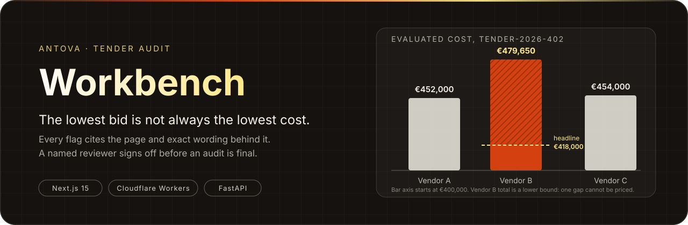
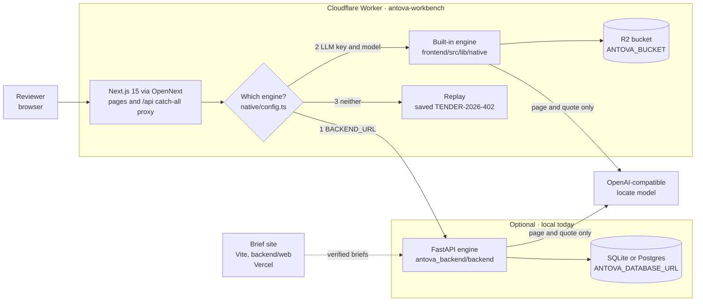
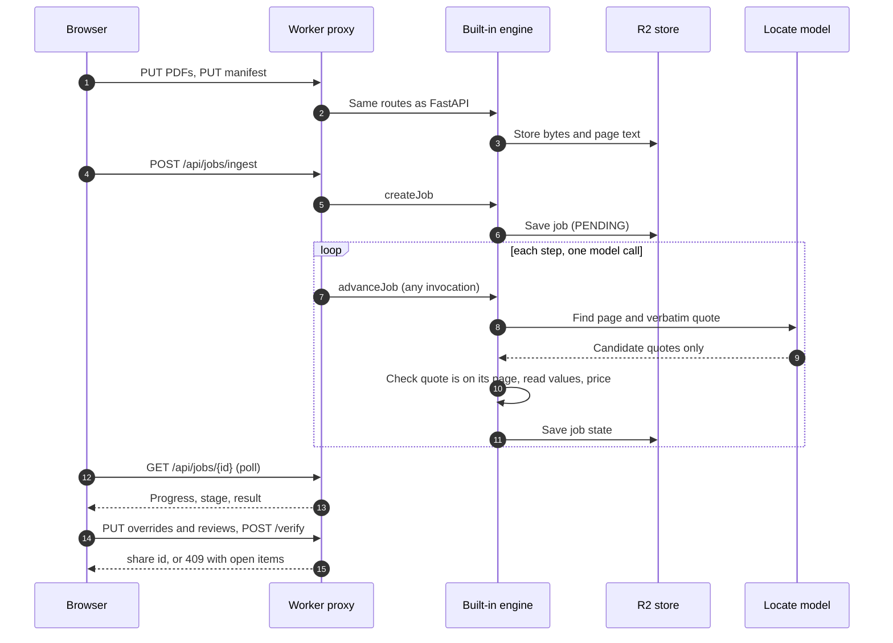
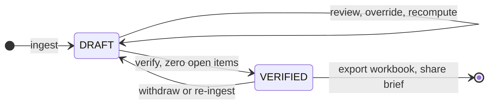
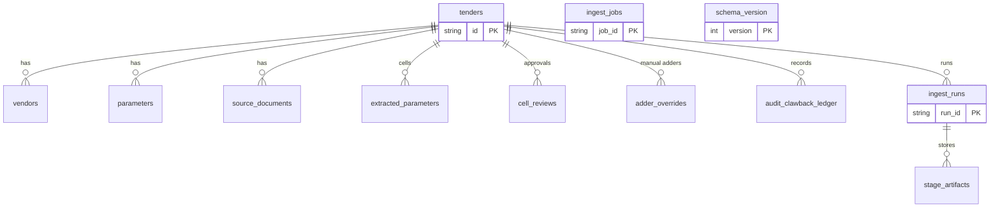
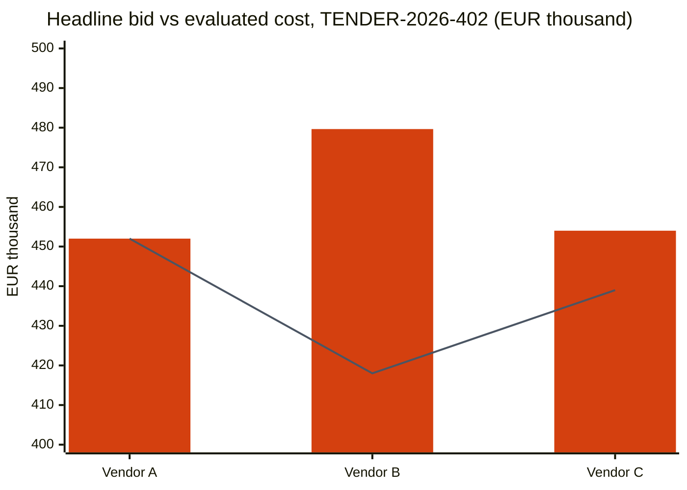

<p align="center">
  
</p>

<h1 align="center">Antova Workbench</h1>

<p align="center">
  <b>The review workbench and serving layer for Antova's bid-audit engine.</b><br/>
  Upload a spec and vendor bids, read every flag against the page it came from,<br/>
  override with a reason, sign off, export.
</p>

<p align="center">
  <a href="https://antova-workbench.akhilfut.workers.dev"><b>Live workbench</b></a> ·
  <a href="https://antova.vercel.app"><b>Website</b></a> ·
  <a href="https://github.com/akhilyad/antova-yc"><b>Engine and product repo</b></a> ·
  <a href="antova_backend/docs/environments.md"><b>Environments</b></a>
</p>

<p align="center">
  <a href="https://github.com/akhilyad/antova-backend-demo/actions/workflows/ci.yml"></a>
  
  
  
  
  
</p>

**Contents:** [Scope](#1-scope-and-relationship-to-antova-yc) · [Requirements](#2-requirements) · [Architecture](#3-system-architecture) · [Request lifecycle](#4-request-lifecycle) · [Review lifecycle](#5-review-lifecycle) · [Data model](#6-data-model) · [API](#7-api-contract) · [Results](#8-results-and-metrics) · [Failure modes](#9-failure-modes-and-trade-offs) · [Layout](#10-repository-layout) · [Setup](#11-local-setup) · [Configuration](#12-configuration) · [Deployment](#13-deployment-topology) · [Status](#14-status-and-known-limits)

---

## 1. Scope and relationship to antova-yc

Antova audits vendor bids against a technical specification: a model finds the quote, code checks and prices it, a named reviewer approves every flag. The product, the audit rules and the evidence design are described in [antova-yc](https://github.com/akhilyad/antova-yc).

This repository is the user-facing part of the system:

- **The workbench** (`antova_backend/frontend`): Next.js dashboard, evidence inspector, override drawer, sensitivity panel, sign-off and printable report.
- **A built-in TypeScript engine** (`frontend/src/lib/native`) that runs the same ingest inside the workbench, so the hosted demo needs no separate engine host.
- **A FastAPI engine** (`antova_backend/backend`) with the serving layer added: request IDs, per-route rate limits, a database health check, a document route for the inspector.
- **A brief site** (`backend/web`, Vite) for read-only verified briefs.

| | `antova-yc` | `antova-backend-demo` (this repo) |
| :-- | :-- | :-- |
| Owns | Audit engine: ingest, rules, review, contract stage | Workbench, built-in engine, serving layer, deployment |
| FastAPI operations | 33 | 23 |
| Tables | 20 | 12 |
| Hosting | Vercel (website) | Cloudflare Workers + R2 |

Engine changes land in `antova-yc` first and are mirrored here. This copy has no contract-stage modules, and `antova-yc` does not yet have this copy's request IDs, rate limits or `documents` route.

## 2. Requirements

| ID | Requirement | Implemented in |
| :-- | :-- | :-- |
| FR-1 | Run an ingest with no separate engine host. | `frontend/src/lib/native/` |
| FR-2 | Choose the engine per request from the environment: remote engine, built-in engine, or replay. | `frontend/src/lib/native/config.ts` |
| FR-3 | Serve the same `/api` routes and JSON from either engine. | `native/handler.ts`, `backend/antova_*_api.py` |
| FR-4 | Show the cited quote on the full source page and as a crop. | `backend/antova_evidence.py`, `GET …/documents/{filename}` |
| FR-5 | Override a priced gap only with a written note. | `PUT …/overrides/{param}/{vendor}` |
| FR-6 | Recompute prices from copper, labour and freight sensitivity without re-ingesting. | `POST …/evaluate`, `native/evaluate.ts` |
| FR-7 | Seal a brief only with zero open items. Export the workbook only after sealing. | `POST …/verify`, `GET …/export-tbe.xlsx` |
| FR-8 | With no engine and no LLM key, serve the saved benchmark read-only. | `frontend/src/lib/replay.ts` |

| Area | Requirement | Where it holds |
| :-- | :-- | :-- |
| Determinism | The model returns a page and quote only. Units, verdicts and money are code. | `native/pipeline.ts` header, `antova_ingest/` |
| Runtime limit | A native ingest runs as saved steps, one model call each, so no step must fit with the others in one 60 s function. | `native/pipeline.ts` (`advanceJob`) |
| Secrets | The LLM key and review token live only as Worker secrets. Nothing `NEXT_PUBLIC_*` is secret. | `docs/cloudflare-workers.md` |
| Auth | `/api` writes are gated by a review token. | `REVIEW_TOKEN`, `ANTOVA_REVIEW_TOKEN` |
| Abuse | Per-client sliding-window limits: evaluate 30, evidence 240, export 20 per minute by default. `429` with `Retry-After`. | `backend/antova_ratelimit.py` |
| Traceability | `X-Request-ID` on every response, one JSON access line per request, shown in UI errors. | `backend/antova_observability.py` |
| Template safety | A placeholder such as `https://your-backend-url-here` is treated as unset, never called. | `native/config.ts` (`isPlaceholder`) |

## 3. System architecture



Rules for choosing the engine, checked on every request:

1. `BACKEND_URL` is a real origin: proxy to that engine.
2. Otherwise `LLM_API_KEY` and `LLM_MODEL_NAME` are set: the built-in engine.
3. Neither: replay mode.

Under `next dev` with no LLM key, the proxy defaults to a FastAPI engine on `http://127.0.0.1:8000`.

## 4. Request lifecycle



Ingest stages, in order: Intake, Parse, Locate (one model call per document), Check each quote is on its page, Read values, Check where documents disagree, Price, Persist.

Every response carries `X-Request-ID`. The proxy creates one per call, the FastAPI engine echoes it, logs it on every line and writes one JSON access line per request on the `antova.access` logger.

## 5. Review lifecycle



A flagged cell is `open`, `reviewed`, `rejected` or `stale`. A re-ingest that changes what the reviewer saw makes the approval stale. The workbook export answers `409` while the brief is a draft.

## 6. Data model

The FastAPI engine in this repo uses 12 tables (`backend/antova_db.py`). The built-in engine stores uploads, page text, manifests, jobs and tenders as objects in R2 (`native/store.ts`: R2, Vercel Blob or local disk).



## 7. API contract

23 FastAPI operations, generated from the app's OpenAPI document. The built-in engine answers the same routes. Routes under `/api/review` and `/api/jobs` need `X-Antova-Review-Token`.

| Method and path | Purpose |
| :-- | :-- |
| `GET /api/health` | Status. FastAPI answers `503` with `degraded` when the database is unreachable |
| `PUT /api/review/tenders/{id}/files/{filename}` · `GET …/files` · `PUT …/manifest` | Intake |
| `POST /api/jobs/ingest` · `GET /api/jobs/{job_id}` | Queue and poll |
| `GET /api/review/tenders` · `GET …/{id}` | List, load a brief |
| `POST …/{id}/evaluate` | Recompute with sensitivity settings (rate limited) |
| `GET …/{id}/evidence/{param}/{source}/{which}.png` | Quote crop (rate limited) |
| `GET …/{id}/documents/{filename}` | Full source PDF for the inspector. Only files the brief lists |
| `PUT/DELETE …/{id}/overrides/{param}/{vendor}` | Manual adder with a note |
| `GET …/{id}/reviews` · `PUT …/{id}/reviews/{param}/{vendor}` | Per-cell approval |
| `POST …/{id}/verify` · `POST …/{id}/withdraw` | Seal, reopen |
| `GET …/{id}/export-tbe.xlsx` · `clarifications.csv` · `clarifications.xlsx` | Exports (rate limited). Workbook is `409` while draft |
| `GET /api/briefs/{share_id}` · `POST …/evaluate` · `GET …/evidence/…png` | Public read-only brief |

Workbench-only routes: `GET/POST /api/ask` answers a question about one cited clause. It forwards to `ANTOVA_QA_URL`, or uses the built-in engine's model when that is unset. With no engine it refuses unless `ANTOVA_QA_PUBLIC=1`.

Health on the hosted workbench reports `mode`, `engine`, `version`, `provider`, `model`, `llm`, `llm_latency_ms` and `storage`.

**Replay mode.** The saved `TENDER-2026-402` is served read-only and marked `x-antova-source: replay`. Any other tender is a 404. Uploads, ingests, decisions and recalculation answer `405` with a message that a live engine is needed. A backend that cannot be reached at all also falls back to replay. A backend that answers, including with 404 or 5xx, is passed through unchanged.

## 8. Results and metrics

Benchmark: synthetic 33 kV switchgear tender `TENDER-2026-402`, three fictional vendors, known answer key.

| Vendor | Headline | Added by gaps | Evaluated | Price status |
| :-- | --: | --: | --: | :-- |
| A | €452,000 | €0 | €452,000 | Fully priced |
| C | €439,000 | €15,000 | €454,000 | Fully priced |
| B | **€418,000** | €61,650 | **€479,650** | Lower bound |



Bars are evaluated cost, the line is the headline bid.

| Metric | Value | How to measure |
| :-- | :-- | :-- |
| FastAPI engine tests collected | 1,120 (Python 3.14) | `cd antova_backend/backend && python -m pytest --collect-only -q` |
| Workbench unit tests | `[TBD: benchmark required]` | `cd antova_backend/frontend && npm run test:unit`, count passes |
| Native ingest wall-clock per bid pack | `[TBD: benchmark required]` | Upload the benchmark to the hosted workbench, time `/api/jobs/{id}` from PENDING to COMPLETED |
| Model cost per tender | `[TBD: benchmark required]` | Native job usage (`LlmUsage` in `native/pipeline.ts`) times the provider's price |
| `evaluate` latency, p95 | `[TBD: benchmark required]` | Call `POST …/evaluate` 100 times, read the `antova.access` log `ms` field |
| Cold-start of the Worker | `[TBD: benchmark required]` | Observability tab in Cloudflare (`observability` is enabled in `wrangler.jsonc`) |

## 9. Failure modes and trade-offs

| Situation | Behaviour |
| :-- | :-- |
| `BACKEND_URL` holds a template value | Ignored. `/api/health` names what it ignored |
| Backend unreachable | Replay mode |
| No engine and no LLM key | Replay mode. Writes answer `405` |
| LLM probe fails | Health reports `llm` status. The ingest form is locked only for real replay |
| Upload over the Worker body limit | `413` with an explanation. `NEXT_PUBLIC_DIRECT_UPLOAD_URL` sends the PUT straight to an engine |
| Client over a rate limit | `429` with `Retry-After` |
| Engine job interrupted by a restart | FastAPI marks it `FAILED` and never re-runs a paid job automatically |
| Provider or internal error during ingest | Job reports a reference only. Detail stays in the server log. Document problems are reported in full |
| Worker storage not durable | Health reports `storage` so ephemeral disk is not mistaken for durable storage |

| Decision | Chosen | Cost |
| :-- | :-- | :-- |
| Built-in engine inside the Worker | Hosted demo with no engine host | Two implementations of the engine to keep in parity |
| Parity pinned by fixtures | CI regenerates sensitivity and financials fixtures from Python and fails on any diff | A Python engine change forces a fixture update |
| FastAPI engine not hosted | Needs a persistent volume and one instance (in-memory queue) | No hosted engine today |
| Replay fallback | The site always serves a verified sample | A user can mistake it for a live run, so it is marked `replay` |

## 10. Repository layout

```text
.
├── antova_backend/
│   ├── frontend/                 Next.js 15 workbench (OpenNext for Cloudflare)
│   │   ├── src/app/              Pages: dashboard, audit, ingest, governance, reports, print, settings
│   │   ├── src/app/api/          /api catch-all proxy and /api/ask
│   │   ├── src/lib/native/       Built-in engine: pipeline, evaluate, handler, llm, store, ontology, values
│   │   ├── scripts/              Node tests, parity generators, mock LLM
│   │   └── wrangler.jsonc        Worker, R2 binding, non-secret vars
│   ├── backend/                  FastAPI engine
│   │   ├── antova_*.py           API, review, upload, briefs, auth, rate limits, observability
│   │   ├── antova_ingest/        Pipeline and rate tables
│   │   ├── web/                  Brief site (Vite)
│   │   ├── Dockerfile  deploy/   Container for a hosted engine
│   │   └── samples/              Reference tenders
│   ├── docs/                     environments, cloudflare-workers, built-in-engine, live-engine-runbook
│   └── start-*.sh  run-tests.sh  Local helpers
└── .github/workflows/ci.yml      Engine, brief site, workbench
```

## 11. Local setup

Requires Node 22 and Python 3.12+.

```bash
# Workbench with the built-in engine (needs an OpenAI-compatible key)
cd antova_backend/frontend
npm install
cp .dev.vars.example .dev.vars        # LLM_API_KEY, LLM_MODEL_NAME, REVIEW_TOKEN
npm run dev                           # http://localhost:3000

# Workbench against a local FastAPI engine
cd antova_backend/backend
pip install -r antova_requirements.txt
ANTOVA_REVIEW_TOKEN=change-me uvicorn antova_api:app --port 8000
curl http://127.0.0.1:8000/api/health

# Tests
python -m pytest -q                                    # engine
cd ../frontend && npm run typecheck && npm run test:unit && npm run test:snapshot
```

## 12. Configuration

Names only. Values belong in the host's secret store. Full matrix: [`environments.md`](antova_backend/docs/environments.md).

| Setting | Secret | Used by |
| :-- | :-- | :-- |
| `LLM_API_KEY`, `LLM_MODEL_NAME` | yes | Built-in engine |
| `LLM_BASE_URL`, `LLM_TIMEOUT_MS` | no | Built-in engine |
| `REVIEW_TOKEN` | yes | Gate on `/api` writes |
| `ANTOVA_BUCKET` | binding | R2 storage |
| `BACKEND_URL` | no | Proxy to a FastAPI engine |
| `ANTOVA_QA_URL`, `ANTOVA_QA_TOKEN`, `ANTOVA_QA_PUBLIC` | url/token yes | `/api/ask` |
| `NEXT_PUBLIC_API_URL`, `NEXT_PUBLIC_DIRECT_UPLOAD_URL`, `NEXT_PUBLIC_LANDING_URL` | no, baked into the bundle | Browser |
| `ANTOVA_REVIEW_TOKEN` or `ANTOVA_REVIEWERS` | yes | FastAPI engine. Container refuses to start without one |
| `ANTOVA_DATABASE_URL`, `ANTOVA_TENDERS_DIR` | no | FastAPI engine |
| `ANTOVA_ALLOWED_ORIGINS`, `ANTOVA_CLIENT_IP_HEADER`, `ANTOVA_RATE_LIMIT*`, `ANTOVA_PUBLIC_DOCS` | no | FastAPI engine hardening |
| `EXPLABS_*`, `ANTHROPIC_API_KEY` | yes | FastAPI engine locate model |

## 13. Deployment topology

| Surface | Code | Host |
| :-- | :-- | :-- |
| Workbench and built-in engine | `antova_backend/frontend` | Cloudflare Workers, R2 bucket `antova-workbench-data`: https://antova-workbench.akhilfut.workers.dev |
| Website | [antova-yc](https://github.com/akhilyad/antova-yc) root | Vercel: https://antova.vercel.app |
| Brief site | `antova_backend/backend/web` | Vercel |
| FastAPI engine | `antova_backend/backend` | None today. `Dockerfile` for one instance with a persistent volume |

Deploy steps: [`cloudflare-workers.md`](antova_backend/docs/cloudflare-workers.md). Build what ships with `npm run cf:build`; deploy with `npm run cf:deploy`. A hosted FastAPI engine must run as one instance (in-memory job queue, local database); the image refuses to start without review credentials.

## 14. Status and known limits

- The benchmark is synthetic: generated documents, fictional vendors, a known answer key. The parser has not been run on customer tenders.
- Scanned pages are flagged, not read.
- The built-in engine and the FastAPI engine are separate implementations. CI pins the sensitivity and financials math to the Python engine with generated fixtures. The rest of the ingest is covered by each engine's own tests, not by a cross-engine comparison.
- The two repositories carry diverged copies of the FastAPI engine. See [section 1](#1-scope-and-relationship-to-antova-yc).
- Operating notes: [`live-engine-runbook.md`](antova_backend/docs/live-engine-runbook.md), [`built-in-engine.md`](antova_backend/docs/built-in-engine.md).

## License

Proprietary and confidential. Copyright © 2026 Antova Inc. All rights reserved.
